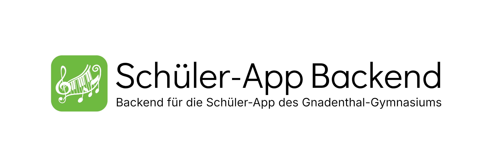

**Deutsch** | [English](README_en.md)

<h1 align="center">
    
</h1>

Läuft auf der Google Cloud Platform (Firebase Functions) in einer Node.js-Laufzeitumgebung.

Hinweis: Diese Anwendung ist kein offizielles Angebot der Schule, wurde aber in Absprache mit der Schulleitung entwickelt und veröffentlicht.

## Funktionen 🚀
✅ **Vertretungsplan-Abruf:**
Das Backend ruft die Website des Online-Vertretungsplans ab, parst die HTML-Daten und extrahiert die folgenden Informationen:

1. Vertretungsplan (eine separate Tabelle für jeden Tag)
2. Nachrichten der Schulleitung
3. Nachrichtenticker (falls verfügbar)
4. Zeitstempel der letzten Aktualisierung seitens der Schule

Diese Daten werden anschließend in die Datenbank (Cloud Firestore) geschrieben.

🔜 **Fehlerstatistiken:**
Protokollierung einfacher Fehlerstatistiken, um den Administrator bei Problemen zu benachrichtigen.

## Support 🚩
Bei Problemen, Bugs, Fragen, Kritik oder Anregungen bitte eine E-Mail an [app-support@lukasengel.net](mailto:app-support@lukasengel.net) schreiben.

## Lizenz 📜
Der Quellcode steht unter der BSD3-Lizenz öffentlich zur Verfügung. Weitere Informationen finden Sie in der Datei [`LICENSE.md`](LICENSE.md).

## Verwandte Repositories 🔗
- Schüler-App: https://github.com/lukasengel/schueler_app