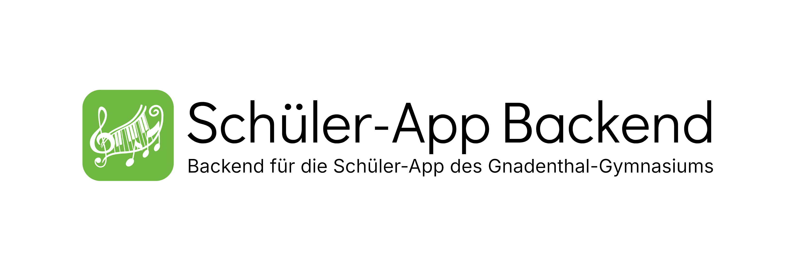

[Deutsch](README.md) | **English**

<h1 align="center">
    
</h1>

Runs on the Google Cloud Platform (Firebase Functions) in a Node.js runtime environment.

Note: This application is not an official service by the school, but was developed and published in agreement with the principal.

## Features 🚀
✅ **Substitution Plan Retrieval:**
The backend fetches the website of the online substitution plan, parses the HTML data and extracts the following information:

1. Substitution plan (a separate table for each day)
2. News from the principal's office
3. News ticker (if available)
4. Timestamp of the latest update by the school

This data is then written to the database (Cloud Firestore).

🔜 **Error Statistics:**
Log simple error statistics to notify the administrator in case of problems.

## Support 🚩
If you encounter any problems, bugs, questions, criticism or suggestions, please send an e-mail to [app-support@lukasengel.net](mailto:app-support@lukasengel.net).

## License 📜
The source code is publicly available under the BSD3 license. For more information, see [`LICENSE.md`](LICENSE.md).

## Related Repositories 🔗
- Schüler-App: https://github.com/lukasengel/schueler_app